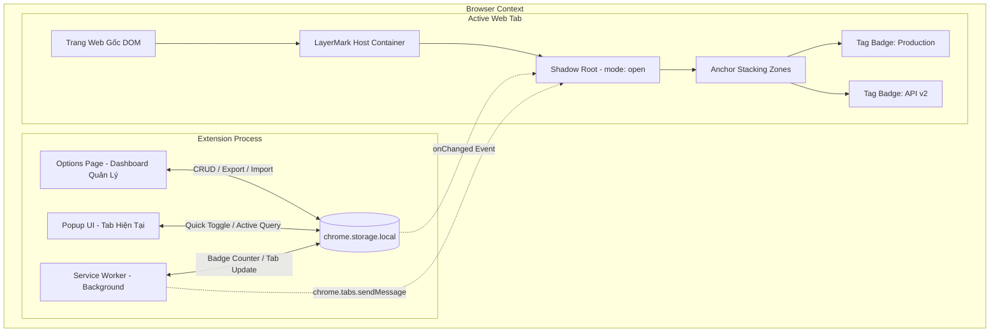

# LayerMark — Kiến Trúc Hệ Thống (Architecture Design)

Tài liệu này mô tả chi tiết mô hình kiến trúc kỹ thuật của tiện ích mở rộng **LayerMark** xây dựng trên nền tảng **Google Chrome Manifest V3**.

---

## 1. Tổng quan Kiến trúc (High-Level Architecture)

---

## 2. Các Thành Phần Kỹ Thuật (Key Components)

### 2.1. Shadow DOM Isolation Layer (`src/content/`)
- **Mục tiêu**: Ngăn cách hoàn toàn giữa style của tiện ích và style của website.
- **Cơ chế**:
  - Tạo một thẻ container `#layermark-root-container` đính trực tiếp vào `document.documentElement`.
  - Thiết lập thuộc tính `pointer-events: none` cho container gốc để mọi click của người dùng xuyên qua bình thường tới trang web bên dưới.
  - Sử dụng `element.attachShadow({ mode: 'open' })`.
  - Toàn bộ stylesheet, SVG icon và component của Tag Badge được render bên trong Shadow Root.
  - Các badge cụ thể được thiết lập `pointer-events: auto` để nhận thao tác click, hover.

### 2.2. Hệ thống Vị trí & Xếp hàng (Anchor Points & Stacking System)
Để hỗ trợ **nhiều tag cùng hiển thị trên một website** mà không bị đè lên nhau, màn hình được chia thành các Docking Zones:

| Anchor Position | Tọa độ CSS | Hướng xếp hàng (Flex) | Ứng dụng tiêu biểu |
| :--- | :--- | :--- | :--- |
| `top-left` | `top: 12px; left: 12px` | `flex-col` hoặc `flex-row` (gap 8px) | Badge thông tin môi trường |
| `top-right` | `top: 12px; right: 12px` | `flex-col` | Nhãn cảnh báo (Production) |
| `bottom-left` | `bottom: 12px; left: 12px` | `flex-col-reverse` | Debug info, tenant ID |
| `bottom-right` | `bottom: 12px; right: 12px` | `flex-col-reverse` | Chi tiết git branch / version |
| `top-banner` | `top: 0; left: 0; width: 100%` | Thanh banner ngang cố định | Cảnh báo toàn trang (PROD CRITICAL) |
| `bottom-banner` | `bottom: 0; left: 0; width: 100%` | Thanh banner ngang cố định | Banner bảo trì |
| `ribbon-top-right`| Góc tam giác chéo bên phải | Góc xoay 45 độ | Corner Ribbon kiểu Github/Staging |

- Khi có từ 2 tag trở lên thuộc cùng một `anchorPosition`, chúng tự động xếp theo thứ tự `priority` tăng dần, cách nhau một khoảng `gap: 6px` đến `8px`.

### 2.3. URL Matching Engine (`src/shared/matcher.ts`)
Công cụ so khớp URL hỗ trợ 5 cấp độ:
1. **Exact Host**: So sánh chính xác hostname (`window.location.hostname === rule.pattern`).
2. **Wildcard Subdomain**: Chuyển đổi pattern dạng `*.domain.com` sang Regex `^.*\.domain\.com$`.
3. **Port Matching**: Hỗ trợ khớp port đối với local dev (ví dụ: `localhost:3000`, `127.0.0.1:8080`, `*:5173`).
4. **Path Pattern**: Hỗ trợ glob khớp đường dẫn (ví dụ: `domain.com/admin/*` hoặc `/checkout/*`).
5. **Regex**: Dành cho người dùng nâng cao khi cần biểu thức chính quy phức tạp.

### 2.4. Lưu trữ và Đồng bộ Reactive (`src/shared/storage.ts`)
- Mọi dữ liệu lưu trong `chrome.storage.local`.
- Lắng nghe sự kiện `chrome.storage.onChanged`: Khi người dùng bật/tắt hoặc sửa tag trong Options Page hoặc Popup, Content Script tại tất cả các tab web đang mở lập tức nhận được event và re-render ngay tức thì mà không cần reload lại trang web.

### 2.5. Hỗ trợ Single Page Applications (SPA)
- Lắng nghe cả 2 nguồn:
  1. Content script hook vào `window.history.pushState`, `window.history.replaceState` và sự kiện `popstate`.
  2. Background Service Worker lắng nghe sự kiện `chrome.tabs.onUpdated` và thông báo cho Content Script khi URL thay đổi.
