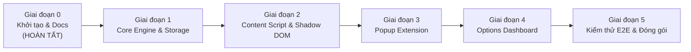

# LayerMark — Kế Hoạch Triển Khai & Lộ Trình (Roadmap)

Lộ trình triển khai chi tiết cho tiện ích mở rộng **LayerMark** theo phương pháp Clean Architecture & TDD.

---

## 🗺️ Tổng quan 5 Giai đoạn Triển khai

---

## Giai đoạn 0: Khởi tạo Kiến trúc & Tài liệu Dự án (Đã Hoàn Tất)
- [x] Khởi tạo git repository và cấu trúc thư mục.
- [x] Cài đặt `pnpm`, Vite, React 18, TypeScript, Tailwind CSS, Lucide Icons.
- [x] Viết file quy chuẩn agent `AGENTS.md`.
- [x] Thiết lập workspace skill `.agents/skills/layermark-dev/SKILL.md`.
- [x] Soạn thảo `docs/ARCHITECTURE.md`, `docs/DATA_SPECIFICATION.md`, `docs/ROADMAP.md`.
- [x] Tạo file build `vite.config.ts` hỗ trợ Manifest V3 đa điểm vào (multi-entry).
- [x] Kiểm thử build thành công ra thư mục `dist/`.

---

## Giai đoạn 1: Core Engine, Storage & Presets
- [ ] Xây dựng module `src/shared/storage.ts`: Wrapper an toàn kiểu dữ liệu cho `chrome.storage.local`.
- [ ] Xây dựng bộ quy tắc mẫu mặc định `src/shared/presets.ts`: Production, Staging, Dev, Localhost.
- [ ] Xây dựng `src/shared/matcher.ts`: URL Matching Engine hỗ trợ 5 chế độ:
  - Exact domain
  - Wildcard subdomain (`*.example.com`)
  - Port (`localhost:3000`, `127.0.0.1:8080`)
  - Path prefix / glob (`site.com/admin/*`)
  - Regex
- [ ] Viết unit tests kiểm thử độ chính xác của Matcher Engine.

---

## Giai đoạn 2: Content Script & Shadow DOM Injection
- [ ] Xây dựng `src/content/shadow-host.ts`: Khởi tạo và quản lý Shadow Root cách ly 100%.
- [ ] Xây dựng `src/content/tag-renderer.ts`: Render danh sách tag theo các Anchor Zone (`top-left`, `top-right`, `bottom-left`, `bottom-right`, `top-banner`, `ribbon`).
- [ ] Xử lý xếp chồng tag (stacking) tự động có khoảng cách giãn dòng.
- [ ] Thêm hiệu ứng thu nhỏ khi rê chuột (hover to minimize) để không che nội dung trang web.
- [ ] Tích hợp theo dõi thay đổi URL trên Single Page Applications (SPA).
- [ ] Lắng nghe `chrome.storage.onChanged` để cập nhật tag tức thì không cần F5 trang web.

---

## Giai đoạn 3: Extension Popup (Tab hiện tại)
- [ ] Hiển thị URL và hostname của tab hiện tại.
- [ ] Liệt kê danh sách các tag đang áp dụng (matching) trên trang này.
- [ ] Cho phép bật/tắt nhanh từng tag ngay tại popup.
- [ ] Nút bấm nhanh "+ Thêm tag cho website này" tự động điền sẵn domain của tab vào modal tạo.
- [ ] Nút mở trang Quản trị tập trung (Options Page).

---

## Giai đoạn 4: Options Dashboard (Quản lý Tập Trung)
- [ ] **Giao diện Dashboard**:
  - Tìm kiếm tag theo tên, domain, ghi chú.
  - Bộ lọc theo môi trường: Tất cả, Production, Staging, Development, Local, Custom.
  - Phân nhóm tag theo Dự án (Project) hoặc Môi trường (Environment).
- [ ] **Thao tác Tag (CRUD)**:
  - Tạo mới tag với modal chi tiết.
  - Chỉnh sửa thông tin, màu nền, màu chữ, icon, kích thước, vị trí anchor.
  - Nhân bản tag (Duplicate).
  - Bật/tắt trạng thái tag.
  - Xóa tag có hộp thoại xác nhận.
- [ ] **Live Preview theo thời gian thực**: Xem trước chính xác giao diện tag khi đang thay đổi màu sắc, icon, kích thước.
- [ ] **Kéo thả sắp xếp thứ tự ưu tiên (Drag & Drop)**: Điều chỉnh vị trí ưu tiên hiển thị trên màn hình.
- [ ] **Sao lưu & Chia sẻ (Import/Export JSON)**:
  - Xuất toàn bộ hoặc chọn lọc tag ra file `.json`.
  - Nhập file `.json` có kiểm tra hợp lệ schema (chọn ghi đè hoặc gộp dữ liệu).

---

## Giai đoạn 5: Đánh giá Chất lượng, Tối ưu & Đóng gói
- [ ] Kiểm tra tương thích CSP trên các website khắt khe (GitHub, Twitter, Banking, AWS Console).
- [ ] Đảm bảo zero-leakage CSS giữa host page và Shadow DOM.
- [ ] Tối ưu dung lượng bundle extension (dưới 300KB).
- [ ] Tạo script đóng gói extension thành file `.zip` sẵn sàng upload lên Chrome Web Store.
