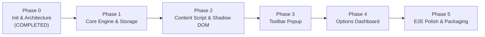

# LayerMark — Implementation Plan & Roadmap

Implementation roadmap for the **LayerMark** extension following Clean Architecture and Test-Driven Development principles.

---

## 🗺️ 5-Phase Implementation Overview

---

## Phase 0: Scaffolding, Architecture & Documentation (Completed)
- [x] Initialize Git repository and project directory structure.
- [x] Configure `pnpm`, Vite 6, React 18, TypeScript, Tailwind CSS, Lucide Icons.
- [x] Author AI Agent guidelines [`AGENTS.md`](../AGENTS.md).
- [x] Set up workspace developer skill [`.agents/skills/layermark-dev/SKILL.md`](../.agents/skills/layermark-dev/SKILL.md).
- [x] Draft technical specifications: [`docs/ARCHITECTURE.md`](./ARCHITECTURE.md), [`docs/DATA_SPECIFICATION.md`](./DATA_SPECIFICATION.md), and [`docs/ROADMAP.md`](./ROADMAP.md).
- [x] Create multi-entry Manifest V3 build pipeline in [`vite.config.ts`](../vite.config.ts).
- [x] Verify clean compilation output to `dist/`.

---

## Phase 1: Core Engine, Storage & Built-in Presets
- [ ] Implement `src/shared/storage.ts`: Strongly typed wrapper for `chrome.storage.local`.
- [ ] Implement `src/shared/presets.ts`: Default presets for Production, Staging, Dev, and Localhost.
- [ ] Implement `src/shared/matcher.ts`: URL Matching Engine supporting 5 pattern types:
  - Exact domain
  - Wildcard subdomain (`*.example.com`)
  - Port matching (`localhost:3000`, `127.0.0.1:8080`)
  - Path prefix / glob (`site.com/admin/*`)
  - Regex
- [ ] Add unit tests covering matcher rules, edge cases, and ports.

---

## Phase 2: Content Script & Shadow DOM Injection
- [ ] Implement `src/content/shadow-host.ts`: Initialize and manage isolated Shadow Root.
- [ ] Implement `src/content/tag-renderer.ts`: Render badge list within designated Anchor Zones (`top-left`, `top-right`, `bottom-left`, `bottom-right`, `top-banner`, `ribbon`).
- [ ] Implement automatic badge stacking with consistent flexbox gaps.
- [ ] Add hover-to-minimize behavior so badges never obstruct interactive elements underneath.
- [ ] Hook into SPA route transitions (`popstate`, `pushState`, `replaceState`).
- [ ] Subscribe to `chrome.storage.onChanged` for instant zero-reload badge updates.

---

## Phase 3: Extension Popup (Active Tab)
- [ ] Display current tab URL and hostname.
- [ ] List all active tags matching the current tab.
- [ ] Provide quick toggle switches for each matched tag.
- [ ] Add quick "+ Add tag for this domain" shortcut button pre-populating current host.
- [ ] Add shortcut link to open full Options Dashboard.

---

## Phase 4: Options Dashboard (Centralized Management)
- [ ] **Dashboard Layout**:
  - Search tags by name, pattern, or note.
  - Filter by environment: All, Production, Staging, Development, Local, Custom.
  - Group tags by Project or Environment.
- [ ] **Tag CRUD Operations**:
  - Create new tag modal with comprehensive visual customizations.
  - Edit background color, text color, icon, size, and anchor position.
  - Duplicate tag shortcut.
  - Toggle tag active status.
  - Delete tag with confirmation dialog.
- [ ] **Real-time Live Preview**: Interactive preview box updating synchronously on color, text, or icon change.
- [ ] **Drag & Drop Priority Reordering**: Adjust stacking order visually.
- [ ] **Import / Export JSON**:
  - Export all or selected tags to `.json`.
  - Import `.json` with schema validation (overwrite or merge modes).

---

## Phase 5: Verification, Quality Assurance & Packaging
- [ ] Test CSP compatibility across strict enterprise sites (GitHub, AWS Console, Twitter).
- [ ] Verify zero CSS leakage between host page and Shadow DOM.
- [ ] Optimize bundle size (under 300KB).
- [ ] Add release packaging script generating ready-to-publish `.zip` archives for Chrome Web Store.
